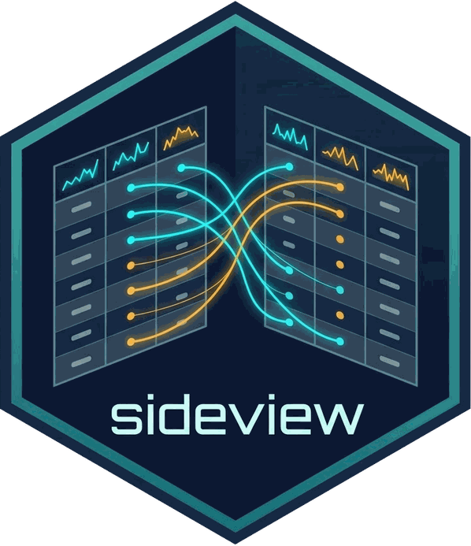
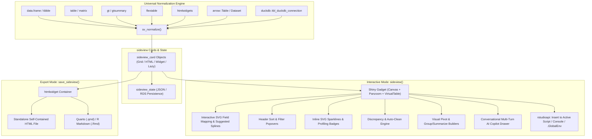

# sideview 

<!-- badges: start -->
[](https://github.com/lauyeehow1986-hub/sideview)
[](https://opensource.org/licenses/MIT)
[](https://lifecycle.r-lib.org/articles/stages.html#experimental)
[](https://cran.r-project.org/)
[](https://github.com/lauyeehow1986-hub/sideview)
<!-- badges: end -->

> **Multi-Table 2D Infinite Canvas for Interactive Data Exploration, Visual Field Mapping, and LLM-Assisted Tidyverse Code Generation**

---

## Overview

When analyzing complex workflows, data scientists frequently work with multiple related tables simultaneously: clinical demographics, longitudinal vitals, lab panels, crosswalk dictionaries, and summary reports. 

Existing tools force analysts into **siloed, tabbed interfaces** where only one table is visible at a time. Switching back and forth between tabs breaks cognitive flow, obscures structural discrepancies, and makes mental reconciliation of column mappings error-prone.

**`sideview`** replaces tabbed viewers with a hardware-accelerated **2D infinite canvas**. You can place any number of heterogeneous tabular datasets side-by-side, zoom and pan freely across the workspace, visually connect columns across tables with interactive SVG splines, sort and filter columns directly on table headers, inspect inline SVG distribution sparklines, automatically detect categorical discrepancies, and generate idiomatic `tidyverse` code that pastes directly into your active RStudio script editor.

```r
library(sideview)

# Launch side-by-side multi-table canvas in RStudio Viewer or Gadget Window
sideview(patients, visits, lab_results, gt_summary)
```

---

## Why `sideview`? Comparison with `dataviewR`

| Feature | `dataviewR` | `sideview` |
| :--- | :---: | :---: |
| **Workspace Layout** | Single-table tabbed view (one table at a time) | **Infinite 2D canvas** (unlimited tables side-by-side) |
| **Navigation** | Basic paging | **Smooth mouse-wheel zoom (15%–350%) & canvas pan** |
| **Table Alignment** | ❌ None | ✅ **Magnetic snap-to-edge docking** |
| **Synchronized Scrolling** | ❌ None | ✅ **Dual vertical (`scrollTop`) and horizontal (`scrollLeft`) sync** |
| **100k+ Row Performance** | ❌ Browser freezing | ✅ **DOM Virtualization (`VirtualTable` ~30 rows active, 60 FPS)** |
| **Big Data Ingestion** | `data.frame` only | ✅ **Apache Arrow (`arrow_table`, `Dataset`) & DuckDB (`tbl_duckdb_connection`)** |
| **Multi-Format Ingestion** | `data.frame` only | ✅ **`data.frame`, `tibble`, `table`, `matrix`, `gt`, `flextable`, `htmlwidgets`** |
| **Interactive Sorting** | ❌ None | ✅ **Tri-state header click (Asc / Desc / Reset) generating `dplyr::arrange`** |
| **Interactive Filtering** | ❌ None | ✅ **Header filter popover (`>`, `<`, `==`, `contains`) generating `dplyr::filter`** |
| **Visual Table Reshaping** | ❌ None | ✅ **Visual `tidyr::pivot_longer()` & `tidyr::pivot_wider()` builders** |
| **Visual Aggregation** | ❌ None | ✅ **Visual `dplyr::group_by()` + `dplyr::summarise()` builder** |
| **Header Column Profiling**| ❌ None | ✅ **Inline SVG 5-bin sparklines, categorical frequency bars, NA badges** |
| **Visual Column Mapping** | ❌ None | ✅ **Click-to-connect interactive SVG splines** |
| **Multi-Key Composite Joins**| ❌ None | ✅ **Composite vector keys (`by = c("k1" = "k1", "k2" = "k2")`) & DAG chaining** |
| **Suggested Splines Copilot**| ❌ None | ✅ **Proactive foreign key detection (`sv_suggest_mappings`) with 1-click accept** |
| **Discrepancy Detection** | ❌ None | ✅ **Vectorized exact & fuzzy string matching with distance scoring** |
| **Auto-Cleanup Rules** | ❌ None | ✅ **1-Click `dplyr::case_when` generation for casing, whitespace, & typos** |
| **Conversational Copilot** | ❌ None | ✅ **Multi-turn dialogue drawer with context retention (20-turn window)** |
| **Workspace Persistence** | ❌ None | ✅ **Serialize & restore full canvas topology (`.json` and `.rds`)** |
| **Console & Script Execution**| ❌ None | ✅ **`Insert Script`, `Run & Exit`, `Run in R` (`.GlobalEnv`), and `Run Console`** |
| **Standalone HTML Export** | ❌ None | ✅ **Self-contained `htmlwidget` (`save_sideview()`)** |
| **Quarto & Rmd Support** | ❌ None | ✅ **Embeddable via `sideview_widget()`** |
| **Automated GUI Testing** | ❌ None | ✅ **Headless DOM & Computer Use verification harness (1,210 tests passing)** |

---

## Architecture Overview

`sideview` is built on a **Dual-Hybrid Architecture**:



---

## Core Capabilities

### 1. High-Performance Infinite 2D Panzoom Canvas & Virtualization
- **DOM Virtualization (`VirtualTable`)**: Renders datasets containing **100,000+ rows** smoothly at 60 FPS by dynamically maintaining a sliding window of ~30 active `<tr>` elements with spacer elements.
- **Mouse Wheel Zoom**: Smooth scaling centered on the cursor position (15% to 350% zoom).
- **Panning & Dragging**: Click-and-drag navigation across the infinite canvas, with magnetic edge-docking for table cards.
- **Dual Synchronized Scrolling**: Locks both vertical rows (`scrollTop`) and horizontal columns (`scrollLeft`) across linked tables.

### 2. Universal Multi-Format Normalization
- **`data.frame` & `tibble`**: Virtualized interactive grid cards.
- **`arrow::Table` & `Dataset`**: Zero-copy schema extraction previewing `head(50)` without materializing multi-gigabyte files.
- **`duckdb` Connections**: DBI query schemas previewing `head(50)` with lazy counts.
- **`gt` & `flextable`**: Styled HTML display while extracting raw data frames (`x[["_data"]]` / `x[["body"]][["dataset"]]`) for tidyverse code generation.
- **`htmlwidgets`**: Embedded container cards.

### 3. Visual Field Mapping & Relational DAG
- **Interactive SVG Splines**: Connect column ports across tables to generate idiomatic tidyverse joins. Click or right-click directly on spline curves to disconnect.
- **Composite Multi-Key Joins**: Draw multiple splines between the same tables to emit composite keys:
  ```r
  patients %>%
    dplyr::left_join(visits, by = c("patient_id" = "patient_id", "site_id" = "site_id"))
  ```
- **Proactive Foreign Key Detection (`sv_suggest_mappings()`)**: Heuristic scoring engine (name similarity, type compatibility, Jaccard value overlap) automatically discovers candidate foreign keys and renders them as animated dashed suggested splines (`.sideview-spline-suggested`) with 1-click acceptance.

### 4. Advanced Visual Wrangling & Profiling
- **Header Column Profiling**: Embedded inline SVG 5-bin distribution sparklines (`<svg class="sideview-sparkline">`), categorical frequency distribution bars, and color-coded missingness badges (`.sideview-na-badge`) with hover range tooltips.
- **Visual Table Reshaping**:
  - `sv_code_pivot_longer()`: Emits `tidyr::pivot_longer()` pipelines.
  - `sv_code_pivot_wider()`: Emits `tidyr::pivot_wider()` pipelines with aggregation (`values_fn`).
- **Group & Summarize Builder**: `sv_code_group_summarize()` generates reproducible `group_by(...) %>% summarise(..., .groups = 'drop')` pipelines.

### 5. Canvas State Persistence & Cloud Sharing
- **Workspace Serialization**: Save and restore complete canvas layouts (pan/zoom, card coordinates, splines, filters, sorts, pipeline code) to `.json` or `.rds`:
  ```r
  # Save active canvas
  sv_save_state(state, file = "study_canvas.json")

  # Load and launch
  sv_load_state("study_canvas.json", launch = TRUE)
  ```

### 6. Conversational AI Copilot Drawer
- **Multi-Turn Context Retention**: Dialogue chat tab in the Action Drawer retaining conversation history, active pipeline R code, and privacy-safe schema summaries.
- **Zero Data Leakage**: Never transmits raw patient records. Works seamlessly with local Ollama (`gemma4:26b`, `llama3.2`) or cloud OpenAI-compatible APIs.
- **1-Click Code Injection**: "Replace Pipeline" updates drawer code, while "Insert into Editor" pastes directly at the cursor via `rstudioapi`.

### 7. Automated Computer Use & Headless GUI QA
- Complete headless DOM test harness (`gui-test-runner.js`) simulating canvas coordinates, card dragging, port connections, suggested splines, and drawer actions across 1,210 automated unit tests.

---

## Installation

Install the development version of `sideview` from GitHub:

```r
# install.packages("remotes")
remotes::install_github("lauyeehow1986-hub/sideview")
```

### Dependencies
- **Core**: `shiny`, `htmltools`, `htmlwidgets`, `dplyr`, `httr2`, `jsonlite`, `rstudioapi`
- **Suggested**: `arrow`, `duckdb`, `DBI`, `shinytest2`, `gt`, `flextable`, `testthat`, `knitr`, `rmarkdown`

---

## Quick Start Examples

### 1. Launch Interactive Gadget with Heterogeneous Tables

```r
library(sideview)
library(dplyr)

# Standard data frame
patients <- data.frame(
  patient_id = c("P01", "P02", "P03", "P04"),
  age = c(45, 52, 38, 61),
  gender_raw = c("Male", "Female", "M", "Fem"),
  stringsAsFactors = FALSE
)

# Tibble
visits <- tibble(
  patient_id = c("P01", "P02", "P03", "P05"),
  systolic_bp = c(120, 140, 115, 130),
  visit_date = as.Date(c("2024-01-10", "2024-01-15", "2024-02-01", "2024-02-10"))
)

# Base R contingency table
dx_freq <- table(c("Hypertension", "Diabetes", "Hypertension", "Asthma"))

# Launch Sideview canvas
sideview(patients, visits, diagnoses = dx_freq)
```

### 2. Including `gt`, `flextable`, and Big Data Objects

```r
library(gt)
library(flextable)

gt_summary <- gt(patients[, c("patient_id", "age")])
flex_visits <- flextable(as.data.frame(visits))

# Both stylized HTML tables and raw data grids are accessible on the canvas
sideview(patients, visits, gt_summary, flex_visits)
```

### 3. Export to Standalone HTML Widget

Share interactive canvas boards as self-contained HTML files with zero external server dependencies:

```r
# Save to an HTML file
save_sideview(
  sideview_widget(patients, visits, diagnoses = dx_freq),
  file = "study_overview.html",
  selfcontained = TRUE,
  title = "Clinical Study Multi-Table Overview"
)
```

### 4. Embedding in Quarto (`.qmd`) or R Markdown (`.Rmd`)

````markdown
---
title: "Clinical Data Harmonization"
format: html
---

```{r}
library(sideview)
sideview_widget(patients, visits, width = "100%", height = "650px")
```
````

---

## Complete Programmatic API Reference

| Function | Module | Description |
| :--- | :--- | :--- |
| `sideview(...)` | Interactive Gadget | Launch Shiny Gadget or RStudio Addin on arbitrary tables |
| `sideview_addin()` | RStudio Addin | Addin entry point registered in RStudio Addins menu |
| `sideview_widget(...)` | Widget | Create an exportable `htmlwidget` instance |
| `save_sideview(widget, file)` | Widget Export | Export canvas to standalone self-contained HTML file |
| `sideviewOutput(id, ...)` | Shiny Integration | Shiny UI widget container |
| `renderSideview(expr, ...)` | Shiny Integration | Shiny server rendering function |
| `sv_normalize(x, name, id)` | Normalization | S3 generic converting tables (data.frame, Arrow, DuckDB, gt, flextable) to cards |
| `sv_find_tables(env)` | Discovery | Detect all tabular objects in an environment |
| `sv_code_join(...)` | Code Generation | Emits `dplyr::left_join`, `inner_join`, `full_join`, `anti_join` with multi-key support |
| `sv_code_pivot_longer(...)`| Code Generation | Emits `tidyr::pivot_longer()` pipelines |
| `sv_code_pivot_wider(...)` | Code Generation | Emits `tidyr::pivot_wider()` pipelines with custom `values_fn` |
| `sv_code_group_summarize(...)`| Code Generation | Emits `dplyr::group_by(...) %>% summarise(..., .groups = 'drop')` |
| `sv_code_arrange(...)` | Code Generation | Emits `dplyr::arrange()` with optional descending order |
| `sv_code_filter(...)` | Code Generation | Emits `dplyr::filter()` expressions |
| `sv_code_rename(...)` | Code Generation | Emits `dplyr::rename()` with non-syntactic backtick escaping |
| `sv_code_mutate(...)` | Code Generation | Emits `dplyr::mutate()` expressions |
| `sv_code_select(...)` | Code Generation | Emits `dplyr::select()` column selections |
| `sv_escape_ident(x)` | Code Generation | Wraps non-syntactic names and reserved words in backticks |
| `sv_detect_discrepancies(...)`| Discrepancies | Vectorized exact & fuzzy Levenshtein discrepancy detection |
| `sv_code_recode(...)` | Discrepancies | Emits `dplyr::case_when()` (or legacy `case_match()`) or `forcats::fct_recode()` |
| `sv_auto_clean_rules(...)` | Discrepancies | Generates automatic `case_when` rules for casing, whitespace, and typos |
| `sv_suggest_mappings(...)` | Copilot | Heuristic foreign key candidate detection across tables |
| `sv_build_chat_prompt(...)` | LLM Engine | Synthesizes multi-turn conversational chat prompt with context retention |
| `sv_build_schema_context(...)` | LLM Engine | Privacy-safe metadata synthesis for LLM prompt |
| `sv_build_prompt(...)` | LLM Engine | Constructs system instructions and user prompt |
| `sv_call_llm(...)` | LLM Engine | Dispatches request to Ollama or OpenAI-compatible backend |
| `sv_extract_code(...)` | LLM Engine | Extracts clean R code from markdown fences |
| `new_sideview_state(...)` | Persistence | Constructor for `sideview_state` object |
| `sv_save_state(state, file)`| Persistence | Serializes canvas workspace layout to `.json` or `.rds` |
| `sv_load_state(file, ...)` | Persistence | Deserializes canvas workspace layout and launches or returns state |
| `sv_is_rstudio_available()` | RStudio Bridge | Checks if RStudio API is available |
| `sv_insert_code(code)` | RStudio Bridge | Inserts text into active document editor |
| `sv_send_to_console(code)` | RStudio Bridge | Sends code to R console for execution |

---

## License

This package is licensed under the [MIT License](LICENSE).

---

## Medical & Diagnostic Disclaimer

`sideview` is an exploratory data analysis, visualization, and code generation tool intended for research, education, and general data science workflows. It is **not certified as medical device software** and is **not intended for clinical diagnosis or patient treatment decisions**.
