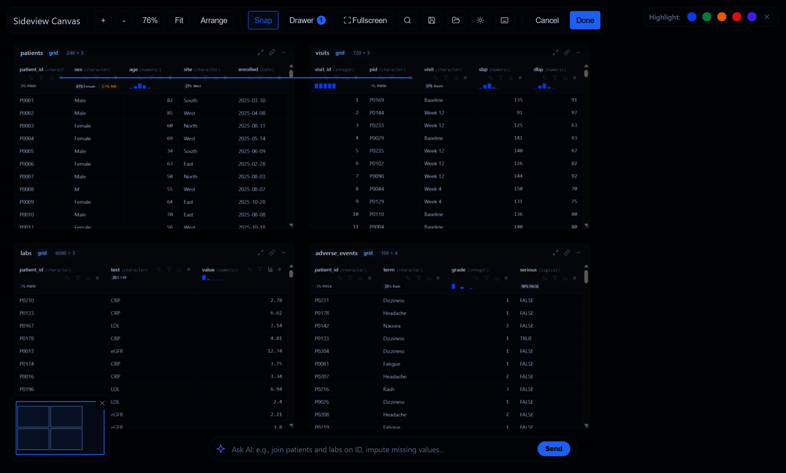
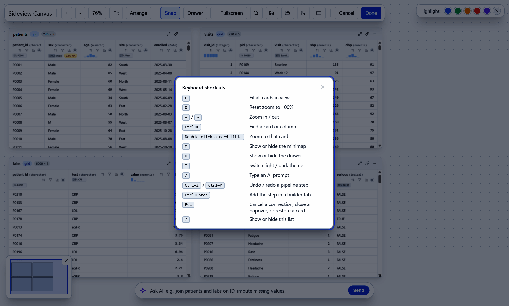

# A visual tour

Every screenshot below comes from this call, run on synthetic study
tables (no real patients):

[`sideview`](https://lauyeehow1986-hub.github.io/sideview/reference/sideview.md)`(``patients``, ``visits``, ``labs``, ``adverse_events``)`

## The canvas

The sideview canvas with four tables: patients, visits, labs and adverse
events

Each table becomes a card. Drag a card by its title, zoom with the mouse
wheel and pan by dragging the background. **Fit** shows every card,
**Arrange** puts them back in a grid and the minimap (bottom left) jumps
to any part of the canvas. Each column header shows its type, a
sparkline and badges for missing values or the most common value.

## Draw a line to join tables

Splines from patients.patient_id to visits, labs and adverse events

Click the round port on a column header, then the port on a column in
another card. sideview draws a spline and writes the `dplyr` join. The
key rows light up in both cards. Connect more columns between the same
two cards for a multi-key join, and click a spline to remove it.

## Check the join before you run it

Join check: one-to-many, 94% of patients matched, rows for each join
type, unmatched keys and fixes

Every new join is checked against the full data, not only the rows on
screen:

- the key relationship (1:1, 1:m or m:m, with a warning for
  many-to-many);
- how many rows match in each direction;
- the number of rows each join type would return;
- example keys that are in one table but not the other;
- fixes such as trimming spaces or ignoring case, and how many more rows
  they would match.

The **Discrepancy** tab also lists near-matching values and can add an
automatic clean-up step.

## Sort and filter from the header

Filter popover on the age column set to greater than 50

Use the arrows in a header to sort and the funnel to filter. In the
gadget both run in R on the whole table, so the result is right for
every row, not only the rows the card has loaded.

## A pipeline you can edit

Pipeline tab with three steps (arrange, filter, left join) and the R
code they make

Each sort, filter, join, rename, recode, mutate, reshape or summarise
becomes a step in the **Pipeline** tab. You can switch a step off, move
it, delete it, undo or redo, and change the join type. The code below
the steps always matches them. Choose `%>%` or `|>`. Then:

- **Insert Script** puts the code at the cursor in RStudio.
- **Run Console** sends it to the console.
- **Run in R** runs it and keeps the result as `sv_result`.
- **Run & Exit** sends it to the console and closes the canvas.

The **Filter**, **Arrange**, **Mutate**, **Recode** and **Summarise**
tabs build steps from a form.

## Inspect a column and export a codebook

Inspect tab for labs\$value: counts, quartiles, a histogram and an
outlier check

The chart button in a header opens the **Inspect** tab: rows, missing
values, distinct values, whether the column is a unique key, quartiles
or top levels, a histogram and data-quality checks. **Export codebook**
writes a data dictionary for every table
([`sv_codebook()`](https://lauyeehow1986-hub.github.io/sideview/reference/sv_codebook.md)).

## Find any card or column

Search dialog listing the patients card and every patient_id column

Press `Ctrl+K` and type part of a table or column name, then press Enter
to zoom to it. Double-clicking a card title also zooms to that card.

## Ask the copilot

Copilot tab answering a question with tidyverse code and buttons to use
it

The **Copilot** tab and the AI bar at the bottom send your question to a
local Ollama model or an OpenAI-compatible service. Only the table
schema is sent (names, types, sizes), never the data rows. **Replace
Pipeline** or **Insert into Editor** uses the answer. The copilot is
optional; everything else works without it.

## Dark theme and keyboard shortcuts

The canvas in the dark theme

The moon button (or `T`) switches between light and dark. The default
follows RStudio’s theme, and `sideview(theme = )` accepts `"light"`,
`"dark"`,
[`sv_theme()`](https://lauyeehow1986-hub.github.io/sideview/reference/sv_theme.md)
or a
[`bslib::bs_theme()`](https://rstudio.github.io/bslib/reference/bs_theme.html).

Keyboard shortcuts dialog

Press `?` for every shortcut.

## Share it as a web page

[`sideview_widget()`](https://lauyeehow1986-hub.github.io/sideview/reference/sideview_widget.md)
gives the same canvas as an htmlwidget for Quarto, R Markdown or
[`save_sideview()`](https://lauyeehow1986-hub.github.io/sideview/reference/save_sideview.md).
In a saved page, join checks, the inspector and the codebook run in the
browser. Buttons that need R are hidden.
