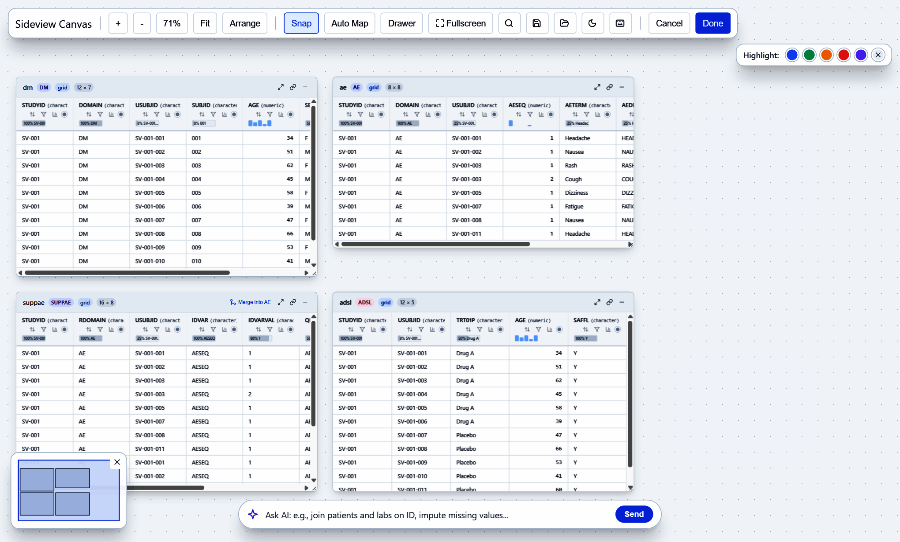
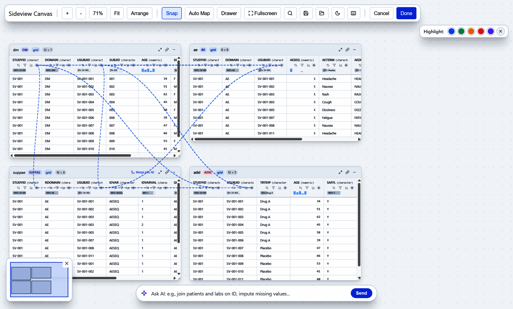
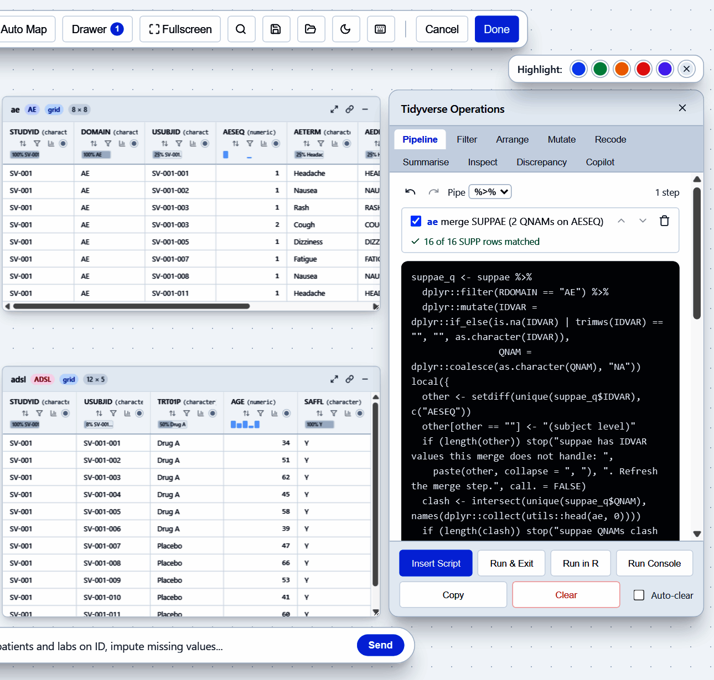

```{r setup, include = FALSE}
knitr::opts_chunk$set(collapse = TRUE, comment = "#>")
library(sideview)
```

sideview recognises tables that look like **SDTM**, **SEND** or **ADaM** datasets and marks them with a
badge. This is for awareness: it helps you see what each card is. It does not check a dataset against an
implementation guide, and a table that does not look like CDISC data is left alone.

Everything below uses a small synthetic study built in the page (no real patients).

## A synthetic study

```{r data}
usub <- paste0("SV-001-", sprintf("%03d", 1:4))
sid <- "SV-001"

dm <- data.frame(STUDYID = sid, DOMAIN = "DM", USUBJID = usub, SUBJID = sprintf("%03d", 1:4),
                 AGE = c(34, 51, 62, 45), SEX = c("F", "M", "F", "M"),
                 ARM = c("A", "B", "A", "B"), stringsAsFactors = FALSE)
attr(dm$USUBJID, "label") <- "Unique Subject Identifier"
attr(dm$AGE, "label") <- "Age"
attr(dm, "label") <- "Demographics"

ae <- data.frame(STUDYID = sid, DOMAIN = "AE", USUBJID = usub, AESEQ = 1:4,
                 AETERM = c("Headache", "Nausea", "Rash", "Cough"),
                 AESEV = c("MILD", "MODERATE", "MILD", "SEVERE"),
                 stringsAsFactors = FALSE)

suppae <- data.frame(STUDYID = sid, RDOMAIN = "AE", USUBJID = usub, IDVAR = "AESEQ",
                     IDVARVAL = as.character(1:4), QNAM = "AETRTEM",
                     QLABEL = "Treatment Emergent", QVAL = "Y", stringsAsFactors = FALSE)

adsl <- data.frame(STUDYID = sid, USUBJID = usub, TRT01P = c("A", "B", "A", "B"),
                   TRT01A = c("A", "B", "A", "B"), AGE = dm$AGE, SAFFL = "Y",
                   stringsAsFactors = FALSE)
```

## Badges

```r
sideview_widget(dm = dm, ae = ae, suppae = suppae, adsl = adsl)
```



Each recognised card gets a badge after its name: `DM`, `AE`, `SUPPAE` and `ADSL` here. Hover over a badge
for the dataset label, the standard and class, and the evidence used (for example "DOMAIN column = DM" or
"STUDYID + USUBJID"). `SUPPAE` also says which parent it supplements. Column headers show a variable's label
as a tooltip, `L` shows a row of labels under the headers (it is saved with the workspace, as `view.labels_row`), and `Ctrl+K`
finds a card by its domain or dataset label.

The tags are worked out in R when the canvas is built. They are never saved in a workspace file; they are
worked out again when it is opened.

## Overrides with `cdisc =`

`cdisc` is `"auto"` by default. Turn it off with `FALSE`, or name the domain of a table that sideview cannot
tell on its own:

```r
sideview_widget(my_events = ae, cdisc = FALSE)
sideview_widget(my_events = ae[, -2], cdisc = c(my_events = "AE"))
```

The same argument is on `sideview()`, `save_sideview()`, `sideviewServer()` and `sv_codebook()`. In a Shiny
module the badges follow `sv_add_card()`, `sv_replace_card()` and `sv_remove_card()`.

## Domains in the codebook

`sv_codebook()` gets a `domain` column, and the widget's CSV download matches it.

```{r codebook}
cb <- sv_codebook(dm = dm, ae = ae, adsl = adsl)
unique(cb[, c("table", "domain")])
```

With `cdisc = FALSE` the column is `NA`.

## The catalogue

```{r catalogue}
cdisc_cat <- sv_cdisc_catalogue()
head(cdisc_cat[, 1:min(5, ncol(cdisc_cat))])
```

The catalogue lists the datasets sideview knows. Its `ig_versions` column (implementation guide versions) is
approximate. It exists so badges can say what a table is, not to validate it.

## Reading CDISC files

`sv_read_cdisc()` reads a folder, or a set of files, of `.xpt`, `.sas7bdat`, Dataset-JSON (`.json`) and
`.parquet` into a named list, keeping variable labels. Names are the lower-case file stems. It needs the
package for each format (haven, datasetjson, arrow), and it never uses the network.

```{r read, eval = FALSE}
study <- sv_read_cdisc("study/sdtm")
sideview_widget(study)
```

Parquet files stay on disk as Arrow Datasets unless you pass `lazy = FALSE`.

## Join keys

Tagged tables join on known keys. With the tables above on the canvas, **Auto Map** (gadget or Shiny module)
suggests them as dashed splines, drawn as one group per join:

```r
sideview(dm = dm, ae = ae, adsl = adsl)
```

| Pair | Keys | Kind |
|---|---|---|
| `adae` to `ae` | `STUDYID`, `USUBJID`, `AESEQ` | ADaM to SDTM trace |
| `ae` to `dm`, `adlb` to `adsl` | `STUDYID`, `USUBJID` | subject level (the hub is the lookup) |
| `lb` to `sv` | `STUDYID`, `USUBJID`, `VISITNUM` | visit level |

An SDTM or SEND table links to `DM`; an ADaM table links to `ADSL` (the other hub is used when the preferred
one is not on the canvas). Hover one spline and the whole group lights up. A click accepts all of it as one
`left_join`, and one undo takes it back. A partial key set is never offered. Without a `STUDYID` column the
subject key is `USUBJID` alone, and the suggestion's reason says so.

The rules are also available as a function, and `sv_suggest_mappings()` returns them first, with `group` and
`kind` columns:

```{r keys}
sv_suggest_mappings(list(dm = dm, ae = ae, adsl = adsl))[, c("from_table", "to_table", "from_col", "to_col", "kind")]
```

### Key checks

Open the join check on a join between two tagged tables and a **CDISC** list appears below the usual
warnings. It names a key the join lacks (`Add AESEQ: the CDISC key for adae and ae is STUDYID, USUBJID,
AESEQ.`), explains a many-to-many join with no rule (two Findings tables such as `LB` and `VS` should be
filtered to one test, or summarised, first) and warns when a natural key repeats. The notes use the
catalogue and the counts already in the check, so they cost no extra pass over the data, and they work for
arrow and duckdb cards too. They do not change what Strict writes.

### What join keys do not do

* `RELREC` tables, and tables without `USUBJID` (`TS`, `TA`, `TE`), are not suggested. `SUPP--` tables are
  merged, not joined (see the next section), so they are left out of the join suggestions above.
* Sponsor sequence names other than `<D>SEQ` are not traced; those pairs get the subject rule.
* Findings with findings (`LB` with `VS`) get a note, not a suggestion.
* The widget has no Auto Map rules and no notes; they are worked out in R, in the gadget and in modules.
* `cdisc = FALSE` turns both off.

## Merging SUPP-- tables

A supplemental qualifier table (`SUPPAE`, `SUPPDM`, or the generic `SUPPQUAL`) holds one row per qualifier:
`QNAM` names the variable, `QVAL` is its value, and `USUBJID`, `IDVAR` and `IDVARVAL` say which parent record it
belongs to. A plain join would multiply the parent rows by the number of qualifiers, so sideview folds the
rows into the parent instead: one new column per `QNAM`, with its `QLABEL` as the column label.

On a tagged `SUPPAE` card, the **Merge into AE** button adds a merge step to
the Pipeline tab. Auto Map offers the same thing as a dashed spline group from the SUPP card to its parent.




Pressing the button again replaces the step with a fresh plan, and one undo takes it back.

The step writes tidyr + dplyr code. When the step is added, sideview records a plan (the type of the key,
the `IDVAR` levels and the `QNAM`s) and writes it into the code, together with guards that stop the code if the
data no longer fits the plan.

### The merge check

`sv_supp_check()` is the check behind the button. It runs on the study above:

```{r supp-check}
chk <- sv_supp_check(ae, suppae, parent_name = "ae", supp_name = "suppae")
chk$status
c(parent = chk$n_parent, supp = chk$n_supp, matched = chk$n_matched, orphan = chk$n_orphan)
chk$columns
```

The same report is shown at the top of the Discrepancy tab (and on the step line in the Pipeline tab):

* counts of parent rows, SUPP rows, matched rows, orphans (SUPP rows that match no parent record, with
  samples) and rows of other `RDOMAIN`s;
* problems: a `QNAM` that repeats for one record, a `QNAM` that clashes with a parent column or sits at two
  `IDVAR` levels, and `IDVARVAL` values that do not convert to the parent's key type (counted apart from
  orphans);
* the new columns with their labels, and a preview of the merged parent.

The status is `error` when the code would stop (repeats, clashes, two-level `QNAM`s, an unsupported key
type), `warning` for orphans and bad `IDVARVAL`s, and `ok` otherwise. A step with an error is still added so
that you can read the report; its step line says that it stops. When a re-check finds that the data no longer
fits the plan (an edited `suppae`, say), the step line reads "Merge needs refreshing" and **Refresh** takes the
plan that re-check found, as one undo step. Refresh runs no check of its own.

With an arrow or duckdb parent, the parent stays lazy: only the SUPP table is collected. With an arrow parent
the code casts a numeric key to the parent's own Arrow type, so an `int64` `AESEQ` from a parquet file joins.
In the widget the check runs in the browser on the embedded rows; when a card's rows were cut (`max_rows`) or
the card is lazy, the panel says "Preview rows".

### Pharmaverse code

The step above is written with `dplyr` and `tidyr`. Set `code_style = "pharmaverse"` (on `sideview()`,
`sideview_ui()`, `sideview_widget()` or `sideviewServer()`; `save_sideview()` takes it too, and its default `NULL` keeps
the widget's style), or pick `pharmaverse` in the pipeline bar's Code select, and an eligible merge is written with
`metatools::combine_supp()` instead. Running that code needs `metatools` 0.3.0 or later. Every other step stays
`dplyr`.

sideview writes `combine_supp()` only when the merge check finds its result equal to the `dplyr` code's. Where it would
not be, the step stays `dplyr` and the step line says why, for example `dplyr: IDVARVAL "01" would not match AESEQ 1 in
combine_supp()`. The merge panel in the Discrepancy tab shows `combine_supp(): yes` or `combine_supp(): no, <reason>`
in both styles. `print(chk)` shows the same line for the reasons `sv_supp_check()` finds on data frames: the first row
and the rows from `<supp> has no <COL> column` to the label row. The other reasons come from the lazy check, the
browser check or the pipeline, and `print()` does not show them. The reasons are:

| Reason | When |
|:---|:---|
| `The merge stops: ...` | The merge itself stops: repeated QNAM records, a QNAM already in the parent, or a QNAM on two `IDVAR` levels. The step line reads `stops: ...`. |
| `combine_supp() needs data frames: <table> is a duckdb table` (or `an Arrow table`) | A card is lazy. |
| `Checked on preview rows only` | The browser check saw only part of the rows. |
| `<supp> has no <COL> column` | A column that `combine_supp()` needs is missing from the SUPP table. |
| `<supp> has extra columns: X, Y` | The SUPP table has columns beyond the SDTM ones. |
| `<parent> has no <COL> column` | A column that `combine_supp()` joins on is missing from the parent. |
| `<parent> has an IDVARVAL column, which combine_supp() would drop` | The parent has that column. |
| `<USUBJID> would not match in combine_supp()` | A subject-level row would join different records. |
| `IDVARVAL "v" would not match <IDVAR> k in combine_supp()`, `IDVARVAL "v" would match <IDVAR> k in combine_supp()` or `IDVARVAL "v" would match a different <parent> record in combine_supp()` | A keyed row would join different records. `combine_supp()` compares keys as trimmed text; the `dplyr` code converts `IDVARVAL` to the key's type. |
| `<IDVAR> would be a factor in combine_supp(), not text` | The parent key is a factor. |
| `DOMAIN would be text in combine_supp(), not a factor` | The parent `DOMAIN` is a factor. |
| `<supp> QNAM is a factor, so combine_supp() would label the wrong columns` | `QNAM` is a factor. |
| `<supp> QLABEL is a factor, so combine_supp() would set factor labels` | `QLABEL` is a factor. |
| `<QNAM> label would be "x" in combine_supp(), not "y"` (either can be `none`) | The two codes would label the column differently. |
| `Column types are not known in the browser` | Browser check only. |
| `<COL> <value> is too close to R's rounding to check in the browser` | Browser check only. |
| `<COL> has values the browser cannot read exactly` | Browser check only. |
| `<supp> has steps before the merge` | The SUPP card has an enabled step other than a custom or derived one. |
| `<parent> has steps before the merge that combine_supp() cannot check` | An earlier enabled step on the parent is not a filter, a sort or a SUPP merge. Those three are allowed. |
| `<parent> has steps after the merge that combine_supp() cannot check` | A later enabled step on the parent is not a filter, a sort or a SUPP merge. The `dplyr` code sets the QNAM labels where the parent's chain ends and `combine_supp()` sets them at the merge, so a later step such as a mutate or a rename of a QNAM column could leave the two results with different labels. Those three are allowed. |
| `Merge needs refreshing` | The data no longer fits the step's plan. The step line shows this text without the `dplyr:` prefix, and the code stays `dplyr`. |
| the check's error | The merge check itself failed (an `{error}` check). `print(chk)` shows `combine_supp(): no, <the error>`; the panel and the step line show `Merge check unavailable`, and the code stays `dplyr`. |

For a `SUPPQUAL` table with rows of other domains, the generated code in this example is 130 lines, 125 of them
the guard block from `local({` to `})`. Most of the block is replaced by a comment below; the code the app writes has
all of it:

```r
suppqual_q <- suppqual %>%
  dplyr::filter(RDOMAIN == "AE")
local({
  p <- ae
  # ... elided here. The elided guards stop when:
  #   - ae is grouped or rowwise with more than one group, or suppqual has grouping columns
  #   - ae has an IDVARVAL column
  #   - suppqual has an IDVAR value this merge does not handle
  #   - suppqual repeats a QNAM for a record
  #   - DOMAIN or AESEQ in ae would not keep its type, or AESEQ would not join
  #   - DOMAIN in ae does not match RDOMAIN in combine_supp()
  #   - an IDVARVAL matches AESEQ as a number but not as text, or as text but not as a number
  #   - a suppqual QNAM would be a column in combine_supp() but not in the dplyr code
  #   - QNAM or QLABEL is a factor
  #   - a QNAM's label in combine_supp() would differ from the merge step's label
})

ae %>%
  metatools::combine_supp(suppqual_q)
```

The guard block checks again when the code runs, and stops with a message. It covers the changes in a later data cut
that were found and tested to make the two results differ or the merge wrong. Besides the guards listed in the comment
above, other merges can have guards that stop for a QNAM on two `IDVAR` levels, for a subject-level row that only
`combine_supp()` would merge, or for a text key that matches only when trimmed. Most messages end "use the dplyr code
style for this merge". The message for an unhandled `IDVAR` says "Refresh the merge step." instead, the one for a
parent key whose type cannot be joined to the `IDVARVAL` values (where both codes would fail) says "convert it before
the merge", and those for a repeated QNAM or a QNAM on two levels give no advice. Some guards are stricter than needed, and in some of the cases
they stop, the `dplyr` code fails too. `combine_supp()` also stops by itself on some changes, such as a new parent
column with the name of a QNAM.

The guards are not a proof that no other difference is possible. On a new data cut, run the merge check again before
you rely on the code. A changed `QLABEL` does not by itself make the step need refreshing: the step keeps the labels
it had when it was added, and the label guard compares with those. A new check can therefore still say
`combine_supp(): yes` while the guard stops the code; add the merge step again to take the new labels. Orphan or unconvertible `IDVARVAL` rows make
`combine_supp()` warn, and the step line says so.

## Rows behind the counts

A join check or a SUPP check ends in counts: how many rows have no partner, how many fell outside a date
window, how many `SUPP--` rows are orphans. In the gadget or a Shiny module each count that is not zero comes
with a button that opens those rows as a card of their own. The card is named for its content (here
`ae_unmatched_dm`), reads the two input cards as they were loaded, and adds one step to the pipeline, so the
generated code rebuilds the same rows. A duckdb or Arrow input stays lazy. In the list view the same offers
are plain buttons.

The console gives the same rows. A synthetic adverse event table with one subject that is not in `dm`, and a
`SUPP--` table with one orphan and one bad `IDVARVAL`:

```{r derived}
ae2 <- rbind(ae, data.frame(STUDYID = sid, DOMAIN = "AE", USUBJID = "SV-001-999", AESEQ = 1L,
                            AETERM = "Dizziness", AESEV = "MILD", stringsAsFactors = FALSE))
sv_unmatched(ae2, dm, "USUBJID")

suppae2 <- rbind(suppae,
                 transform(suppae[1, ], IDVARVAL = "99"),
                 transform(suppae[2, ], IDVARVAL = "x"))
sv_supp_orphans(ae, suppae2, rdomain = "AE")
sv_supp_orphans(ae, suppae2, rdomain = "AE", what = "bad_idvarval")
```

With a date rule, `sv_unmatched(x, y, by, rule = ..., what = "outside_window")` gives the rows that have a key
partner but no pair the rule keeps; `what = "unmatched"` gives the rows with no key partner at all.

Notes:

* The rows come from the tables as loaded, not from a pipeline result: a filter on the card does not change them.
* In a Shiny module, removing an input removes the cards derived from it, and adding the input back brings them
  back; replacing it rebuilds them from the new data.
* The widget has no R, so it offers no buttons; a saved state's derived steps stay in its code but the derived tables are not shown there.

## Stacking tables

Visits that arrive as separate files (one per wave, one per site) have to be stacked before they are analysed,
and the columns rarely line up: `AGE` is numeric in one file and text in the next, a column is spelt `Age`
in one table and `AGE` in another. `sv_stack_check()` compares the columns of 2 to 8 tables and says, for each
column, its type in every table, its label, and what a stack would do with it. A synthetic two-wave example:

```{r stack}
wave1 <- data.frame(USUBJID = c("S-01", "S-02"), AGE = c(34, 51), SEX = c("F", "M"),
                    stringsAsFactors = FALSE)
wave2 <- data.frame(USUBJID = c("S-03", "S-04"), Age = c("29", "40"), SEX = c("M", "M"),
                    stringsAsFactors = FALSE)
sv_stack_check(wave1, wave2)
```

Here `Age` in `wave2` is a near miss for `AGE` in `wave1`, so the check offers to rename it; the check says so
and changes nothing until you choose. A type that differs is cast to the type the check shows (or the one you
choose), a value that cannot be cast becomes `NA` and is counted, and the stacked table has exactly the sum of the
rows. A `source` column holds each row's table name.

```{r stack2}
chk <- sv_stack_check(wave1, wave2, rename = c(Age = "AGE"))
sv_stack(wave1, wave2, check = chk)
```

On the canvas, the **Stack** tab of the drawer (and the Stack builder of the list view) does the same: pick two or
more tables, press **Check**, change a fix if you want one, and press **Open** to add the stacked table as a card
named after the first table you ticked (`wave1_stacked` when `wave1` is ticked first). The generated code
rebuilds the table with `dplyr::bind_rows()`, so a script reproduces the card; R builds the card itself from the
same plan, and the code R writes is byte-equal to the code the browser writes. A duckdb or Arrow input stays lazy:
the stack is one `union_all` on a duckdb connection and is never collected.

Dates and times: a date-time cast to a date is its UTC date, and a date cast to a date-time is midnight UTC,
shown in the zone the stack keeps. A table in memory and a duckdb or Arrow table give the same values.

Limits to know:

* Some casts change values without counting an `NA`: a date-time cast to text drops fractional seconds, a number
  cast to text keeps 15 significant digits, and an `integer64` column that is cast is read as a double first, so
  digits beyond 2^53 are lost.
* Stacking a duckdb or Arrow table needs the duckdb package; without it the check and **Open** say so.
* duckdb reads two names that differ only in case (`AGE`, `Age`) as one name, so a duckdb or Arrow stack with such
  a pair left apart is refused: tick **Rename** to merge them, or rename one first.
* The code for a lazy table whose columns are date-times cast to text writes the time zone of the session that
  made it (`Sys.timezone()`), so code generated on another machine can differ in the zone only.
* A number cast to text is written by R as `"1e+05"` where a duckdb stack writes `"100000"`; whole numbers in
  ordinary ranges agree, very large or small ones may not.
* A duckdb table carries no column labels, so its columns have none in the stack; an Arrow table keeps its labels.
* The widget has no R: it shows no Stack tab, and a saved state's stack step stays in the code but the table is not
  shown there.

## What it does not do

* The `ig_versions` in the catalogue are approximate, and nothing is validated against an implementation
  guide.
* A table named `AD...` (`ADLB`, `ADAE`, `ADVS`) is tagged ADaM when its columns confirm an ADaM structure,
  even if it keeps SDTM-prefixed columns such as `LBTESTCD`; the tooltip records the prefix as a
  disagreement. With any other name, SDTM-prefixed columns still give an SDTM tag.
* Column names are matched whatever their case (`STUDYID`, `studyid`), but a `STUDYID` column is still
  required for tagging. The SUPP merge is stricter: it needs the exact upper-case names `USUBJID`, `IDVAR`,
  `IDVARVAL`, `QNAM` and `QVAL` (and `STUDYID`, `RDOMAIN` and `QLABEL` when present).
* There is no hard limit on merges, but the checks are uneven. A second merge into one parent (a `SUPPAE` and
  a `SUPPQUAL`) is checked in the browser, where a `QNAM` already made by an earlier merge, `mutate` or
  `rename` counts as a clash. The guard inside the generated code looks only at the source parent table, so
  after an earlier join, summarise, pivot or custom step the browser cannot see the chain's columns either,
  and dplyr would add `.x`/`.y` suffixes instead of stopping.
* The check runs when you press the Merge button, when you open the step line or the report, after opening a
  workspace, after undo or redo, and after a module card is replaced or removed. Refresh runs no check, and
  nothing checks when the code runs: if the data change later, only the guards in the generated code stop a
  rerun on new data.
* `IDVARVAL` is matched after conversion to the key type. The in-memory R check compares a double key as 15
  significant digits of text, while the generated code and the lazy duckdb check compare the doubles
  themselves, and the browser reads the shortest round-trip text. So for a double key with more than 15
  significant digits the gadget's own report can disagree with its code, and the gadget with the widget. A key that does not look like a plain decimal (`"0x10"`, `"Inf"`, `"1d3"`) is
  counted as a bad `IDVARVAL`.
* `cdisc = FALSE` shows no tags, but lazy (arrow / duckdb) cards still run detection when they are built.
  A named `cdisc =` vector with several lazy cards gets slower with each verb.
* Dataset-JSON reading was checked against `datasetjson` 0.4.1; if a file's structure differs, it is skipped
  with a warning.
* The Copilot gets column labels and a domain line as schema text, never row data.
* The label row is placed from one measurement of the header height, so it could sit off if a header grows
  taller later.
* The interface was checked in headless Chrome and by hand in RStudio's dialog and Viewer pane. In an external browser the canvas was seen to load, but its interaction was covered only by the headless Chrome tests (see the log for the release).
